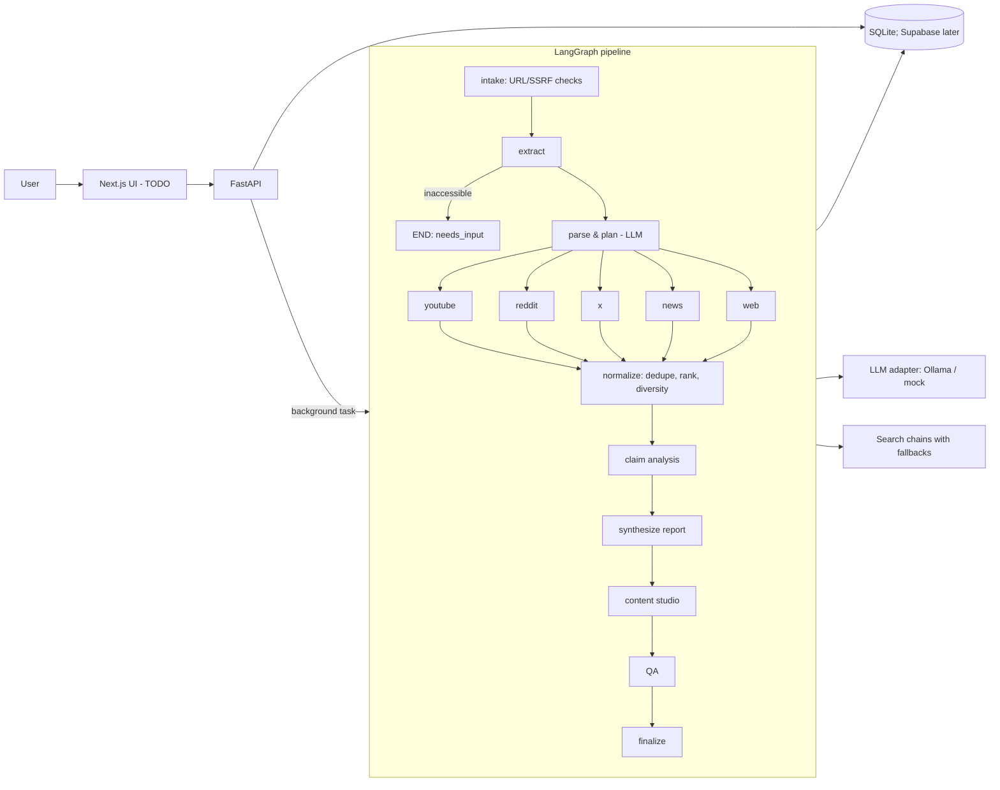

# Architecture

## Where each requirement lives
| Requirement | Code |
|---|---|
| Typed state, schemas | `packages/agent/state.py`, `packages/agent/schemas/models.py` |
| Graph, parallel fan-out + join | `packages/agent/graph.py` |
| Model adapter (configurable, JSON repair, fallbacks) | `packages/providers/llm/` |
| SSRF protection | `packages/providers/extraction/url_safety.py`, applied on every redirect hop |
| Never pretend to read blocked content | `extractor.py` returns `inaccessible`; graph ends in `needs_input` |
| Prompt-injection defence | prompts fence untrusted text; pattern flagging; LLM output validated; no tool can be triggered by text |
| Retries/timeouts/budgets | `agent/tools/resilience.py`, `config.py` |
| Citation integrity | claims/report citations filtered to stored evidence ids; QA re-checks |
| Originality | QA flags 8+ consecutive copied words |
| Persistence, history, deletion | `packages/db/repository.py` (delete cascades events) |

## Provider fallbacks (documented restrictions)
- **YouTube**: Data API (needs key) -> web search `site:youtube.com`. Transcripts are not fetched automatically; user can paste one.
- **Reddit**: public JSON search (often blocked without OAuth) -> web search `site:reddit.com`.
- **X**: API is paid; best-effort web search `site:x.com`. Coverage will be partial; the QA report shows category counts.
- **News**: GDELT (keyless) -> Brave news / Tavily news.
- **Web**: Tavily -> Brave. With no keys configured, web/X return nothing and the report is marked low-evidence instead of inventing sources.

## Known gaps / roadmap
Next.js frontend, PDF export, Supabase/pgvector (embeddings dedupe currently token-Jaccard), Celery/Redis queue,
LangGraph checkpointing + human-review interrupts, auth, OpenTelemetry, real-model benchmark of 2 open-weight models.
